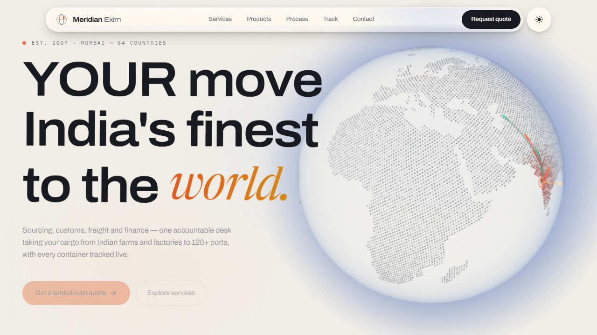

# UI and UX 1st 🌐

> **High-Performance Interactive 3D WebGL & Modern Scrollytelling Experience**



A flagship digital experience combining **Swiss Typographic Rigor**, **Industrial Maritime Telemetry**, and **Apple-grade Micro-Interactions**.

---

## 📁 Project Architecture & Modular Source (`src/`)

```text
UI-and-UX-1st/
├── src/
│   ├── components/
│   │   ├── AccreditationMarquee.jsx  # Continuous infinite marquee of 8 regulatory badges
│   │   ├── BootLoader.jsx            # 000 -> 100 manifest countdown & 5-blade shutter reveal
│   │   ├── CommoditiesCatalog.jsx    # 8 3D-tilt flip cards with HS code spec sheets
│   │   ├── ContainerScroll.jsx       # 340vh cargo integrity sequence + sensor telemetry
│   │   ├── ExportJourney.jsx         # 6-step factory-to-destination export lifecycle
│   │   ├── Footer.jsx                # Multi-column footer with 5 live trading desk clocks
│   │   ├── HeroGlobe.jsx             # Three.js 3D WebGL point-cloud globe & shipping routes
│   │   ├── Navbar.jsx                # Floating Liquid Glass capsule & spring active tab bubble
│   │   ├── QuoteWizard.jsx           # 3-step interactive landed-cost quote builder
│   │   ├── ServicesBento.jsx         # 5 interactive bento cards (Sea, Air, Customs, QC, Warehouse)
│   │   ├── ShipmentTracker.jsx       # Simulated live cargo tracking & WhatsApp alert demo
│   │   ├── Testimonials.jsx          # 4.9/5 verified importer review carousel
│   │   └── ThemeProvider.jsx         # View Transitions API circular ripple dark/light switcher
│   ├── data/
│   │   ├── commodities.js            # 8 commodities (HS codes, origins, MOQs, packaging)
│   │   ├── company.js                # Brand identity, performance metrics, accreditations
│   │   ├── ports.js                  # 13 global port coordinates & shipping transit days
│   │   ├── services.js               # 5 logistics services & 6 export lifecycle stages
│   │   └── testimonials.js           # Verified buyer reviews & procurement details
│   ├── App.jsx                       # Master page layout assembling all sections
│   ├── index.css                     # Tailwind tokens, Liquid Glass shaders & keyframe animations
│   └── main.jsx                      # React 19 application entry point
├── assets/                           # Production compiled bundles & 3D container chunks
├── land.json                         # 22,206 coordinate vertices for the WebGL 3D globe
├── index.html                        # Zero-FOUC boot container & font preloads
├── package.json                      # Scripts & dependencies (Vite, React 19, Three.js, GSAP)
├── server.py                         # Zero-install local Python HTTP server
└── vite.config.js                    # Vite bundler configuration
```

---

## 🚀 Running the Project

### Option A: Standard Vite Developer Workflow
```bash
# 1. Install dependencies
npm install

# 2. Start local development server with Hot Module Replacement (HMR)
npm run dev

# 3. Build for production
npm run build
```

### Option B: Zero-Install Standalone Mode
If you don't want to install `node_modules`, run directly with Python:
```bash
python server.py
```
Open your browser at:
```text
http://localhost:5173
```

---

## ✨ Interactive Features & Shader Highlights

- 🌍 **Three.js WebGL Interactive 3D Globe**: Point-cloud sphere rendered with custom shaders and geodesic bezier shipping corridors connecting 13 global ports.
- ⚡ **GSAP ScrollTrigger Pinned Scrollytelling**: Deep 460vh Hero timeline and 340vh interactive cargo container breakdown.
- 🌊 **Liquid Glass (`.lg`) Physics**: Custom chromatic aberration displacement normal maps, dynamic specular highlights (`--lx`, `--ly`), and inset sheen borders.
- 🌓 **Circular Ripple Theme Switcher**: Fluid dark/light transition driven by the native View Transitions API (`startViewTransition`).
- 🏎️ **Lenis Smooth Scrolling**: Ultra-responsive inertia scrolling with automatic pause on modal/menu interactions.
- 🗂️ **Interactive Commodities Flip Cards**: 3D-tilt spec sheet flip cards with HS codes, origin details, and MOQ telemetry.
- ⏱️ **Live Trading Desk Clocks**: Real-time world clocks for Mumbai, Dubai, Rotterdam, New York, and Singapore.
- 📱 **Low-Power GPU Optimization**: Automatic 75% polygon reduction and noise filter stripping for mobile devices (`(pointer: coarse)` and `hardwareConcurrency <= 4`).

---

## 🎨 Design System Tokens

- **Primary Display Font**: Archivo (`font-stretch: 112%`)
- **Editorial Accent**: Newsreader (Italic)
- **Technical Monospace**: IBM Plex Mono
- **Primary Colors**:
  - Dark Surface (`--ink`): `#06080f`
  - Bone Typography (`--bone`): `#ece8df`
  - Beacon Signal Orange (`--signal`): `#ff6b2c`
  - Secondary Signal Gold (`--signal-2`): `#ffb547`
  - Maritime Sea Cyan (`--sea`): `#46d6c8`

---

## 📄 License
MIT © [Akshay Katiyar](https://github.com/Akshay-Katiyar)
